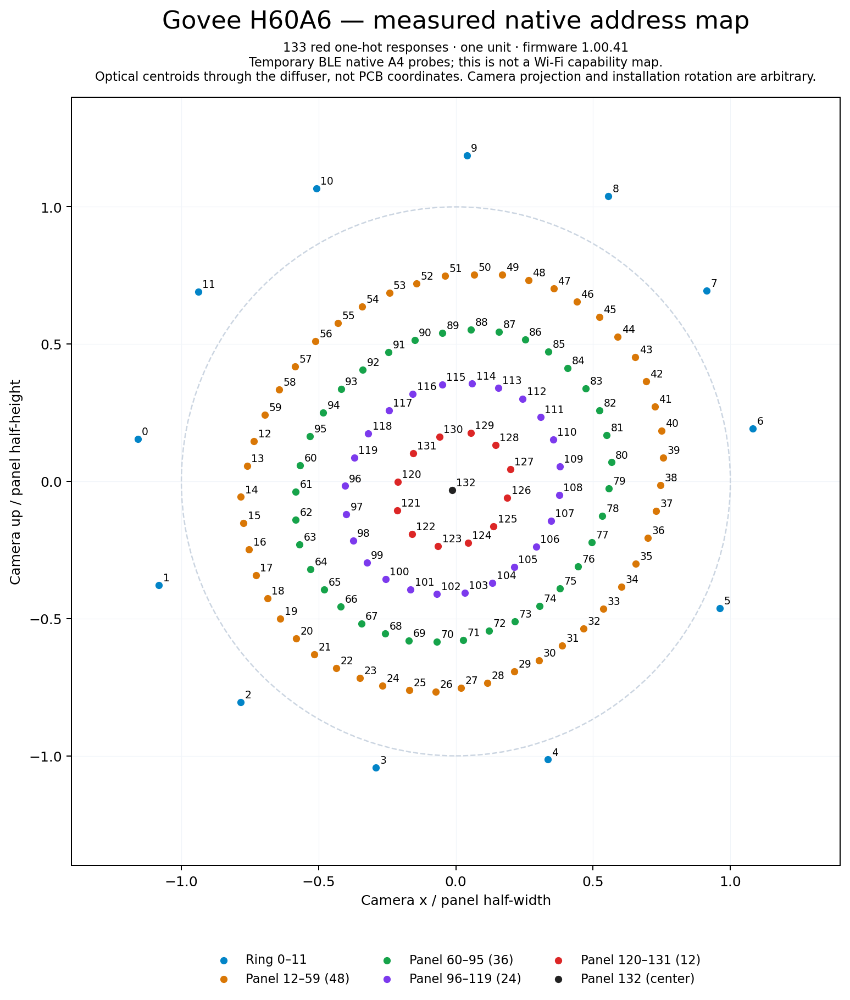

# H60A6 native address map and transport observations

Measurements from one Govee H60A6, Wi-Fi/BLE firmware 1.00.41, hardware 1.04.03,
collected October 15–16, 2026. This snapshot accompanies
[govee-local-api issue #190](https://github.com/Galorhallen/govee-local-api/issues/190#issuecomment-6222262935).
It contains generated figures, optical measurements and exact protocol fixtures.
Original room photographs, device identifiers, private addresses and account data
are omitted. No account/API key was used for the local controls.

**The native map was measured with temporary Bluetooth probes. It does not
establish native scene uploads or 133-address control over Wi-Fi.** Bluetooth was
a reference instrument for this investigation, rather than a proposed permanent
relay for Home Assistant.

## Native address map

| Native index, inclusive | Count | Observed region                |
| ----------------------- | ----: | ------------------------------ |
| 0–11                    |    12 | Top/ambient ring               |
| 12–59                   |    48 | Bottom panel, outer band       |
| 60–95                   |    36 | Bottom panel, next band        |
| 96–119                  |    24 | Bottom panel, next band inward |
| 120–131                 |    12 | Bottom panel, innermost band   |
| 132                     |     1 | Bottom panel, center           |

These are **133 independently exercised native address responses**, not a count
of physical LED packages or dies established by teardown. Coordinates are optical
centroids seen through the diffuser from one camera position. Installation
rotation, camera projection and ceiling reflections affect their positions;
absolute angles must not be treated as a universal mounting orientation. The SVG
and PNG contain generated plot marks only, with no original photograph pixels.

Three address spaces need to remain distinct:

| Interface                         | Addressing demonstrated on this unit                                 |
| --------------------------------- | -------------------------------------------------------------------- |
| Native A4 scene program, over BLE | Ring 0–11; panel 12–132, including spatial patterns within the panel |
| Basic BLE RGB color groups        | Ring 0–11; whole panel at group 12                                   |
| Tested LAN `razer` B0, 12 samples | Ring 0–11; whole panel copies ring sample 11                         |

Changing a LAN segment count to 133 or 13 would not expose the native layout.
The native panel's spatial rendering also cannot be reproduced by the tested
LAN path's single flat panel color alone.

## How the map was measured

The known **Rustling leaves**, code **19155**, A4 program supplied the template.
Its single layer has action 1 and speed 0. Probes changed RGB/index groups and,
where labeled, background RGB; other program fields were preserved. Each plan
covered indices 0–132 exactly once and was parsed, rebuilt, dechunked and checked
for XOR correctness offline before sending.

The initial hypothesis that the last 12 addresses belonged to the top ring was
rejected: those addresses illuminated the panel center. The next split, 0–11
versus 12–132, separated the ring and panel in both red/blue orientations. A
40/32/24/16/8/1 panel-band hypothesis produced partial/mixed annuli and was also
rejected. Those original fixtures are retained rather than relabeled.

Revised **48/36/24/12/1** masks were declared before testing. They produced
concentric regions with red-chroma radial peaks approximately 0.82, 0.60, 0.41,
0.18 and 0.01 times the camera panel radius, repeated in two frames.

The final sweep used all **133 red one-hot probes in seeded random order**
(seed 601330), an all-black control and five blue cross-checks at 0, 11, 12, 59
and 132: **139 program plans** in total. All red addresses yielded distinct,
usable centroids. The closest pair, 62/63, was 8.82 camera pixels apart. Blue
cross-check centroids were 1.64–4.38 pixels from their red counterparts.

The raw points remain separate from descriptive affine-circle fits. Fit RMS
residuals for the four panel bands were 1.55, 0.88, 0.51 and 0.32 pixels; the top
ring's reflected glow was more distorted, at 8.23 pixels. These fits describe
camera observations and do not establish PCB geometry.

Relevant files:

- [One-hot plans and exact A4 frames](native-onehot-fixtures.json)
- [Optical centroids, source-image hashes, cross-checks and fits](native-onehot-measurements.json)
- [Revised radial masks and background controls](native-radial48-fixtures.json)
- [Measured radial profiles](native-radial-measurements.json)
- Rejected [121/12 split](native-index-fixtures.json) and [40/32/24/16/8/1 bands](native-radial-fixtures.json)
- [Editable SVG map](native-address-map.svg)

The numerical measurement files retain anonymous experiment filenames and
original-image SHA-256 hashes for provenance; the images themselves are private.

## Background color can prevent an indexed-black program from being dark

In the tested A4 action-1 template, setting all 133 indexed RGB colors to black
still emitted visible light while the program background was (255, 221, 149).
Changing only background RGB to black made the program visibly dark, although
power remained on, brightness was 5% and scene code remained 19155. The one-hot
and final ring/panel masks used a black background to remove this confound.
This is a result for that program/template, rather than every A3/A4 action or
white-channel mode.

## Native scenes: upload and activation are separate

Full matching BLE upload plus explicit activation visibly rendered these known
catalog programs:

| Scene           |  Code | Upload format       |
| --------------- | ----: | ------------------- |
| Graffiti        | 19076 | A3 / DIY            |
| Christmas       | 19093 | A3 / DIY            |
| Rustling leaves | 19155 | A4 / pixel graffiti |
| Aurora          | 19074 | A4 / pixel graffiti |

The activation is a 20-byte XOR-checked frame beginning `33 05 04`, followed by
the scene code as a little-endian uint16. Exact uploads and activations are in
[native-stage-fixtures.json](native-stage-fixtures.json).

A different parameterized scene's **bare BLE activation could return the requested
scene code, logical power on and brightness 5%, yet render darkness**. This
occurred both across formats and within the same format. Previously running the
target scene did not establish reliable later recall by code alone.

Uploading Aurora while its code was selected but dark did not illuminate it until
another explicit Aurora activation. Uploading Graffiti while Rustling ran left
Rustling visible until Graffiti activation. This supports an upload-then-activate
sequence; firmware slot ownership, caching and persistence remain unproven.
Activation-only White Light (code 99) is a separate case.

The [slot results](native-slot-results.json), [slot fixtures](native-slot-fixtures.json),
[staging results](native-stage-results.json) and
[camera statistics](native-stage-camera-measurements.json) preserve these controls.

## What the Wi-Fi cross-checks did and did not show

With a valid native source program visibly running, local UDP `ptReal` target
uploads were tried as a batch and as individual datagrams spaced 30 ms apart.
The same-format pairs were Rustling → Aurora (A4) and Graffiti → Christmas (A3).
After each attempted Wi-Fi upload, BLE target activation still rendered darkness,
matching the no-new-upload control. Full BLE target upload plus activation then
rendered the target. Wi-Fi activation-only left the source code/appearance
unchanged. Thus no usable cross-transport staged upload was demonstrated.

A further control sent identical valid raw brightness bytes beginning `33 04 08`
while a full BLE Christmas program was visibly running. UDP `ptReal` left
brightness at 5%; the same bytes over BLE changed both LAN and BLE brightness
readings to 8%. This establishes byte validity while narrowing the failure to
the tested transport/envelope/context. It does not prove every possible local
native path is impossible.

The earlier slot suite's brightness comparison followed a physically dark bare
Graffiti activation. Its original label claimed a native program was active,
but only the code was selected. That context is explicitly corrected in
`native-slot-results.json`; the later, visibly running Christmas repeat in
`native-stage-results.json` supplies the qualified brightness comparison.

No raw packet capture or observation of a phone-app action with Bluetooth disabled
was obtained. These are application-level commands and observations. Whether the
Govee phone app uses a different local peer protocol or the cloud for these
native actions remains unresolved. A Wi-Fi connection alone does not establish
use of a local API.

## LAN grouping and Home Assistant implications

Nine predeclared arbitrary-palette predictions matched all 13 basic BLE RGB groups
([arrays and readbacks](grouping-readback-results.json)). For N LAN B0 samples,
`q = floor(12 / N)`: each of the first N−1 colors occupies q ring groups and the
last fills the remainder. The panel copies ring position 11. With N > 12, q is
zero and only the last color is visible; N = 13 does not add a panel address.

After ordinary 2700 K white, a one-sample black B0 makes the panel dark while the
ring stays white. Global brightness adjusts the visible ring. Both native zone
power flags remain true: this is a color-mode behavior rather than independent
zone-power control. The exact top-only sequence, pacing and limitations are in
[the original issue comment](https://github.com/Galorhallen/govee-local-api/issues/190#issuecomment-6222262935).

LAN status exposes one RGB value, following ring group 0. RGB/Kelvin can retain
preceding values during native effects; matching code/RGB readback is insufficient
to establish physical rendering. Top-only and flat color patterns survived
brightness changes, software off/on and idle checks, but mains power-cycle
persistence was not tested. A B1 disable did not restore the preceding scene.

This supports bounded maintained features such as a top-only preset. It does not
yet support two fully independent, accurately reported LAN light entities.

## Catalog decoding and attribution

The anonymous public H60A6 catalog snapshot contained 82 entries: 14 A3/DIY,
57 A4/pixel-graffiti and 11 activation-only. All 71 parameterized programs were
parsed/rebuilt/reassembled byte-for-byte offline. Catalog `sceneType=5` does not
mean command byte 5: the leading catalog marker `50` is stripped, command `58`
is used, and the device-specific shape chooses A3 or A4 framing.

Graffiti is code 19076, an 86-byte A3 value with two 37-byte layers using
sub-effect 1 and reversed rainbow palettes, blue background and background
brightness 65. Unnamed fields retain their schema labels; their semantics have
not been inferred from names alone.

- [Decoded catalog atlas and limits](native-scene-atlas.json)
- [Graffiti decoded structure](graffiti-decoded.json) and [exact frames](graffiti-device-specific-frames.json)
- [Representative format fixtures](native-format-fixtures.json)

The reference decoder/encoder is
[Brady-Woods/govee-ble-local, commit 374a3a3](https://github.com/Brady-Woods/govee-ble-local/tree/374a3a30bb0216e6cbeca0bcaebe57e00ebc2b54),
particularly `spec/govee_ble.ksy` and the generated readers (MIT; the
[license is included](BRADY-WOODS-MIT-LICENSE.txt)). Scene program data originated
from Govee's anonymous public catalog. Measurement analysis and custom probe
plans were prepared for this investigation. The framing correction is proposed
separately in [ha-govee-local-scenes PR #2](https://github.com/casi-3/ha-govee-local-scenes/pull/2);
correct framing alone did not make native scenes execute over the tested LAN path.
